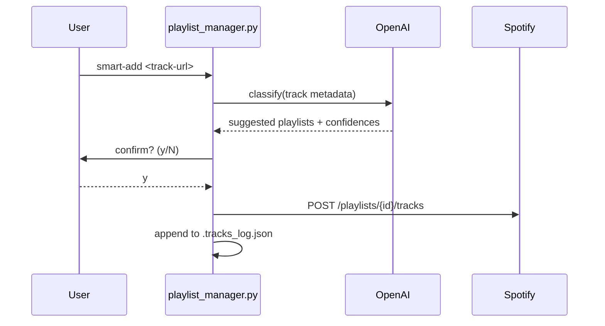

# Writing Documentation

How to write and maintain documentation in this project. These rules apply whenever Claude or a developer writes or updates any `.md` file — [docs/](../../docs/), [.claude/docs/](.), [README.md](../../README.md), or any other markdown.

---

## Contents

**Part 1 — Principles**
- [The Core Rule: Reference, Don't Duplicate](#the-core-rule-reference-dont-duplicate)
- [Sources of Truth](#sources-of-truth)
- [Audience Determines Location](#audience-determines-location)
- [Language](#language)
- [Where Does This Content Go?](#where-does-this-content-go)

**Part 2 — Writing Mechanics**
- [Document Lifecycle Markers](#document-lifecycle-markers)
- [Link Structure](#link-structure)
- [Lists, Tables, and Structure](#lists-tables-and-structure)
- [Table of Contents](#table-of-contents)
- [Diagrams](#diagrams)
- [Formatting Alignment](#formatting-alignment)

**Part 3 — Maintenance**
- [Keeping Docs Current](#keeping-docs-current)
- [Staleness Signals](#staleness-signals)
- [Outdated and Legacy Documentation](#outdated-and-legacy-documentation)
- [Common Mistakes](#common-mistakes)
- [Writing Anti-Patterns](#writing-anti-patterns)

---

## Part 1 — Principles

---

## The Core Rule: Reference, Don't Duplicate

**Every piece of information should live in exactly one place.** When another document needs to refer to it, link to the source of truth — never copy the content.

```
✓ Good — link to the source of truth
"See [docs/commands.md → add](../../docs/commands.md#add) for the duplicate-guard behavior."

✗ Bad — copies behavior into another guide
"The `add` command always reads .tracks_log.json before writing, skipping URIs that are already logged."
  → this behavior is documented in docs/commands.md; now you have two places to keep in sync
```

When content is duplicated, it will eventually diverge. One copy gets updated; the other goes stale. The reader gets confused. The solution is to pick the source of truth and link from everywhere else.

---

## Sources of Truth

| Concern | Source of truth | Notes |
|---------|-----------------|-------|
| **Code & data** |  |  |
| CLI subcommands, flags, behavior | [playlist_manager.py](../../playlist_manager.py) | `argparse` definitions are authoritative; docs follow the code |
| Playlist taxonomy (categories, aliases, special rules, catch-all) | [playlists.json](../../playlists.json) | Gitignored. Schema lives in [playlists.example.json](../../playlists.example.json) |
| Python dependency ranges | [requirements.txt](../../requirements.txt) | Versions never duplicated into prose |
| Fallback duplicate-guard log | `.tracks_log.json` | Gitignored, auto-managed by the CLI; only read when Spotify hides a playlist's contents |
| Spotify OAuth token cache | `.spotify_token_cache` | Gitignored, auto-managed by Spotipy |
| **User-facing docs** |  |  |
| Project overview, primary entry point | [README.md](../../README.md) | Short — points to the three guides below |
| Credentials, `.env`, venv setup, Spotify connection | [docs/setup.md](../../docs/setup.md) | Spotify Developer Dashboard, OpenAI platform, connecting to Spotify and connection troubleshooting, `playlists.json` bootstrap |
| WSL + VS Code + Claude Code setup | [docs/vscode-claude-setup.md](../../docs/vscode-claude-setup.md) | Optional developer environment walkthrough |
| `/event-radar` output folder | [docs/events/README.md](../../docs/events/README.md) | Describes the generated event lists (written in Dutch, see [Language](#language)) |
| End-user CLI reference | [docs/commands.md](../../docs/commands.md) | Every subcommand, dry-run behavior, duplicate guard, aliases |
| Code structure, OAuth flow, OpenAI classifier, IPv4-only WSL workaround | [docs/architecture.md](../../docs/architecture.md) | The "why" behind the code |
| **Claude runtime context** |  |  |
| Slash-command (skill) index | [.claude/docs/commands.md](commands.md) | One row per skill; full reference lives in each `SKILL.md` |
| Skill authoring guide and maturity framework | [.claude/docs/writing-skills.md](writing-skills.md) | 7-level model, folder layout, frontmatter rules |
| Documentation conventions (this file) | [.claude/docs/writing-docs.md](writing-docs.md) | Loaded by Claude when editing any `.md` |
| Skill maturity dashboard | [.claude/skills/skill-level-overview.html](../skills/skill-level-overview.html) | Refreshed by [update-skill-overview.sh](../skills/update-skill-overview.sh) |
| Individual skill logic and rules | `.claude/skills/<name>/SKILL.md` | Don't restate skill rules in `.claude/docs/` — link to the `SKILL.md` |

---

## Audience Determines Location

Each document has one target audience. Don't mix them.

| Audience | Location | Style |
|----------|----------|-------|
| End user running the CLI | [docs/](../../docs/) | Task-oriented, plain language, copy-pasteable commands |
| Developer setting up the project | [README.md](../../README.md) + [docs/setup.md](../../docs/setup.md) | Technical, precise — venv, env vars, Spotify connection |
| Claude / skill runtime | [.claude/docs/](.) + [.claude/skills/](../skills/) | Instruction-style, precise — loaded into the model's context at runtime |

**Developer-only setup details do not belong in user-facing docs.** Conversely, end-user CLI semantics belong in [docs/commands.md](../../docs/commands.md), not in `.claude/docs/`.

---

## Language

**All documentation is written in English** — `docs/`, `.claude/docs/`, `README.md`. Filenames also must be English (`setup.md`, not `installatie.md`). One exception: [docs/events/README.md](../../docs/events/README.md) accompanies the Dutch `/event-radar` output and is written in Dutch.

**Skill output language is a separate concern.** Skills like [`/playlist-match`](../skills/playlist-match/SKILL.md) produce **Dutch** user-facing prose because the user authored the format spec in Dutch — but the `SKILL.md`, its `references/`, `templates/`, and `examples/` stay in English so triggers and steering remain model-readable. Quoted Dutch strings inside English docs MUST be annotated: `` `welke playlist past hierbij` (Dutch trigger phrase for /playlist-match) ``.

---

## Where Does This Content Go?

Use this when you're not sure which file to write new content into.

1. **Is it _how to use a CLI subcommand_?** → [docs/commands.md](../../docs/commands.md)
2. **Is it _credentials, `.env`, or venv setup_?** → [docs/setup.md](../../docs/setup.md)
3. **Is it _why the code is structured the way it is_ (OAuth flow, classifier design, network workarounds)?** → [docs/architecture.md](../../docs/architecture.md)
4. **Is it the _project overview_ for someone landing on GitHub?** → [README.md](../../README.md) (keep short — link out)
5. **Is it _runtime instructions for Claude_ (skill rules, slash-command behavior)?** → `.claude/skills/<name>/SKILL.md` (or its subfolders); index it in [.claude/docs/commands.md](commands.md)
6. **Is it a _convention_ about how to write skills or docs across the repo?** → [.claude/docs/writing-skills.md](writing-skills.md) or [.claude/docs/writing-docs.md](writing-docs.md)
7. **Is it the _playlist taxonomy_ (a category, alias, special rule)?** → [playlists.json](../../playlists.json), with schema notes in [playlists.example.json](../../playlists.example.json)

If you're still unsure: write it once in the most specific location and link from everywhere else. When content could fit in two places, it almost always belongs in the more authoritative one (CLI argparse over docs prose, `SKILL.md` over a guide in `.claude/docs/`) and should be referenced from the other.

---

## Part 2 — Writing Mechanics

---

## Document Lifecycle Markers

### The `[Future]` Marker

For functionality that is not yet implemented but is on the roadmap, mark sections with `[Future]`:

```markdown
## Bulk export to CSV [Future]

A future subcommand will dump every track in a target playlist to CSV.
```

**Adding the marker:**
- Only mark features that are actively planned. Don't document speculative ideas — if you don't know when they'll ship, don't document them yet
- Write the section body in future tense
- Avoid `[Future]` in `.claude/docs/` and `SKILL.md` — those are runtime instructions, not announcements

**Removing the marker — not just deletion:**
When a feature ships:
1. Switch future tense to present tense
2. Verify the description matches what was actually built — planned and implemented are not always identical
3. Update example commands and expected output
4. Remove any "once implemented…" caveats

### The `[Legacy]` Marker

See [Outdated and Legacy Documentation](#outdated-and-legacy-documentation) for when to use `[Legacy]` and how to handle deprecated content.

---

## Link Structure

- Use **relative paths** for internal links, not absolute paths
  - Good: `[setup](../../docs/setup.md)`
  - Bad: `/home/wilco/spotify-playlist-manager/docs/setup.md`
- **Verify linked files exist** before writing the link — a broken link is worse than no link
- For section links, use the GitHub anchor format: `#section-name-lowercase-hyphenated`
- For external Spotify or OpenAI references, link to the canonical docs:
  - [Spotify Web API](https://developer.spotify.com/documentation/web-api)
  - [Spotipy](https://spotipy.readthedocs.io/)
  - [OpenAI API](https://platform.openai.com/docs)

---

## Lists, Tables, and Structure

### When to use a list

**Bulleted list** — unordered items with no inherent sequence:
- Three or more items that would be awkward as a run-on sentence
- Items where order doesn't matter

**Numbered list** — always use when sequence matters:
- Step-by-step instructions
- Ordered procedures where skipping or reordering a step would cause problems

Avoid lists for fewer than three items — prose is usually cleaner: "`add` and `smart-add` both honor the duplicate guard" is better than a two-item bullet list.

### When to use a table

Use a table when each item has **two or more parallel attributes**:
- Comparing options across a consistent set of criteria
- Mapping one thing to another (subcommand → effect, env var → purpose, category → behavior)
- Reference material readers will scan rather than read linearly

Don't use a table for a simple list of items with a single attribute — that's a bulleted list.

### Ordering rows in a table

- **Lifecycle or workflow order** — when rows represent phases or steps (preferred for the CLI subcommand table)
- **Most-used first** — when the table is a lookup reference readers scan frequently
- **Alphabetical** — only when there is no logical order and readers are likely to search by name
- Avoid insertion order or random order

### Ordering list items

- Put the most important or most common item first
- Use consistent grammatical parallelism — all items start with the same form (all imperatives, all noun phrases, all clauses)
- For instructional lists, use the order the reader should encounter the items

---

## Table of Contents

**Add a ToC when:**
- The document has 5 or more sections and is longer than ~50 lines
- The document serves as an overview or index (any `README.md`)
- The document is a guide that readers navigate non-linearly (e.g. [docs/commands.md](../../docs/commands.md))

**Don't add a ToC when:**
- The document is short (under ~50 lines)
- The document has a single coherent top-to-bottom flow
- The document is primarily a single table or reference list

### Keeping the ToC up to date

- Use GitHub anchor format: `#section-name-lowercase-with-hyphens`
- When you add, rename, or remove a section heading, update the ToC in the same edit — never leave them out of sync
- Before adding a ToC link, verify the anchor matches the exact heading text (GitHub derives anchors from heading text, with spaces replaced by `-` and special characters stripped)

---

## Diagrams

Prefer diagrams over prose when the relationship between things is genuinely hard to express linearly — state transitions, multi-party flows, decision branches. Don't add a diagram just to make a doc look thorough; a clear table or numbered list is often better.

**Use Mermaid** for all new diagrams. Mermaid renders natively in GitHub, lives as text in the file (so it can be diffed and updated), and requires no external assets.

✓ **Good** — inline Mermaid, lives with the doc, diffs cleanly:



**Mermaid diagram types and when to use them:**

| Type | Use for |
|------|---------|
| `flowchart` | Process flows, decision trees |
| `sequenceDiagram` | Multi-party interactions (user ↔ CLI ↔ OpenAI ↔ Spotify) |
| `stateDiagram-v2` | State machines — e.g. dry-run / confirmed / executed transitions |
| `erDiagram` | Data shape relationships (rare in this repo) |

**Where diagrams live:** inline in the document that uses them — never in separate files. Never copy a diagram into two documents; put it in the most authoritative location and link from the other.

**When not to use a diagram:** when a table, numbered list, or short prose communicates the same thing clearly, or when the underlying process changes frequently (prose is cheaper to update than a Mermaid block).

---

## Formatting Alignment

Correct visual alignment in tables and ASCII diagrams makes documentation easier to read, edit, and maintain. Misaligned source is a sign of a partial edit — fix it when you touch the file.

### Markdown tables

GFM renders tables regardless of source padding, but readable source matters for editing. When writing or updating a table:

- **Separator rows** (`|---|---|`) must span the full width of each column — a one-character `|-|` under a wide column signals the row was added without checking alignment
- **Cell padding** should be visually consistent across rows in the same column
- **Pipe characters** (`|`) must be present on both ends of every row

✓ Well-aligned:

```markdown
| Subcommand | Behavior                       |
|------------|--------------------------------|
| add        | Single-target add              |
| smart-add  | OpenAI classifier + confirm    |
```

✗ Misaligned separator — won't break rendering, but signals a partial edit:

```markdown
| Subcommand | Behavior                       |
|--|--|
| add        | Single-target add              |
```

### ASCII box diagrams

ASCII diagrams use box-drawing characters to show lifecycle or flow order. Misalignment here is immediately visible to anyone reading the raw file.

- **Vertical bars** (`│`) must sit in the same column on every row in the same block
- **Label/description spacing** must be consistent
- **Borders** must be complete — `┌` and `┐` at the top, `└` and `┘` at the bottom, `─` filling horizontal lines without gaps

**When editing any file that contains a table or diagram:** check the entire table/diagram for alignment before saving — not just the rows you changed. A partial fix that leaves other rows misaligned is worse than leaving everything as-is.

---

## Part 3 — Maintenance

---

## Keeping Docs Current

A stale doc is worse than no doc — it misleads. After any change that affects documented behavior:

1. Update the source-of-truth file first (usually [playlist_manager.py](../../playlist_manager.py) or [playlists.json](../../playlists.json))
2. If the change affects a `docs/` guide (user-facing), update that too
3. Check for cross-references in other docs and update them if needed
4. Refresh the skill dashboard (`bash .claude/skills/update-skill-overview.sh`) if anything inside `.claude/skills/` changed

---

## Staleness Signals

When reading or reviewing documentation, certain patterns are signals to stop and verify before trusting.

| Pattern found in a doc | What to check |
|------------------------|---------------|
| `[Future]` | Whether the feature has since been implemented |
| `[Legacy]` | Whether the content can now be fully removed |
| `TODO` / `TBD` in a shipped doc | Whether it needs resolving or a proper `[Future]` marker |
| Hardcoded Python version | [requirements.txt](../../requirements.txt) for what is actually targeted |
| Hardcoded package versions in prose | [requirements.txt](../../requirements.txt); never duplicate versions into prose |
| Environment variable names | [.env.example](../../.env.example) to confirm the variable still exists |
| Subcommand names (`add`, `smart-add`, `review-playlist`, …) | `python playlist_manager.py --help` to confirm they still exist and accept those flags |
| Flag names (`--execute`, `--accept-all`, `--all`) | The argparse definitions in [playlist_manager.py](../../playlist_manager.py) |
| Playlist category names | [playlists.json](../../playlists.json) `categories.*` and `special_rules` |
| References to `.tracks_log.json` semantics | The duplicate-guard implementation in [playlist_manager.py](../../playlist_manager.py) and [docs/architecture.md → Duplicate detection](../../docs/architecture.md#duplicate-detection) |
| Slash-command names (`/playlist-match`, …) | `.claude/skills/<name>/` to confirm the folder still exists |
| Links to other docs | Whether the linked file and section still exist |
| Mermaid diagrams (states, sequences) | Whether the underlying process or parties still match reality |
| Code block examples with commands | Whether the syntax or argparse contract still holds |

---

## Outdated and Legacy Documentation

Docs accumulate. Some sections go stale, some get superseded by code changes, and occasionally a whole file outlives its purpose. Knowing when to update, move, mark, or delete is as important as knowing how to write.

### When to update in place

Update a section when the underlying facts changed but the content's purpose and location are still correct:

- A flag was renamed, an env var changed, or a step was added
- A `[Future]` marker should be removed because the feature shipped
- A link points to a file that was moved or renamed

### When to move content

Move content when it is in the right state but the wrong place — usually because the audience changed:

- Implementation details that ended up in [docs/commands.md](../../docs/commands.md) → move to [docs/architecture.md](../../docs/architecture.md)
- Runtime instructions for Claude that ended up in a user-facing guide → move to a `SKILL.md` or `.claude/docs/`
- A CLI semantic copy-pasted into multiple guides → keep it in [docs/commands.md](../../docs/commands.md), replace the other copies with links

When moving, always replace the old location with a short link to the new one. Never just delete without redirecting.

### When to mark as legacy

Use a `[Legacy]` marker when content describes something that still works but should no longer be used or recommended:

- An old credential setup procedure replaced by an automated step
- A manual workaround that is now handled by the script

```markdown
## Manual playlist seeding [Legacy]

> This approach predates the `log-import` subcommand. Use `python playlist_manager.py log-import …` instead — it parses Exportify CSVs and seeds `.tracks_log.json` automatically.
```

### When to remove a section

Remove a section outright (not just mark it) when:

- The feature it describes was removed from scope entirely
- The content is factually wrong and there is no "old way" worth preserving
- The section is pure duplication of a source of truth elsewhere — replace with a link

### When to remove an entire file

Remove a whole doc file when all its content is superseded by another file, or when its audience no longer exists. Before deleting, grep for the filename across all `.md` files to find incoming links. Update or remove them first.

### Handling large duplicates

When two docs describe the same thing at length, don't merge them line by line. Instead:

1. Pick the source of truth (see the table above)
2. Keep the full content in the source-of-truth file
3. In the other file, replace the duplicate block with a one-line link: `See [X](path/to/file.md).`
4. Before removing the copy, check whether it contains any updates the source of truth is missing — merge those in first

---

## Common Mistakes

| Mistake | Fix |
|---------|-----|
| Copying argparse `--help` output into prose | Link to [docs/commands.md](../../docs/commands.md); regenerate examples from the actual CLI |
| Hardcoding a package version in prose | Link to [requirements.txt](../../requirements.txt) |
| Writing implementation details in [docs/commands.md](../../docs/commands.md) | Move them to [docs/architecture.md](../../docs/architecture.md) |
| Restating a skill's rules in `.claude/docs/commands.md` | Keep the row short; link to the `SKILL.md` for the full ruleset |
| Using absolute file paths in links | Use relative paths |
| Writing Dutch in `.claude/docs/`, `README.md`, or `docs/` | English only for documentation; Dutch belongs in skill *output*, not documentation |
| Marking a feature `[Future]` after it ships | Remove the marker when the feature is live |

---

## Writing Anti-Patterns

The mistakes above are structural — wrong place, wrong audience, wrong format. These are writing-style patterns that make documentation go stale faster or harder to read.

### Before removing an anti-pattern, check the note's purpose

Anti-pattern detection (especially time-sensitive language and forward-looking statements) is a heuristic, not a verdict. Some notes that *look* like an anti-pattern are actually load-bearing context that future readers need:

- **A note that explains *why* something is the way it is today** ("the IPv4-only flag is here because WSL2's IPv6 stack drops Spotify's auth redirect") communicates a known constraint and its rationale. Stripping it leaves the workaround unexplained.
- **A note acknowledging a current model behaviour** ("Claude currently undertriggers skills, so write descriptions slightly pushy") flags that the *advice* depends on an *observation*. Removing the qualifier converts an observation into a permanent claim and the advice can age into nonsense if the observation no longer holds.
- **A note pointing at a known-broken state** ("this is a workaround until Spotify exposes track lists on dev-tier apps again") is the only signal that the workaround is temporary. Without it, future readers may treat the workaround as the intended design.

Before rephrasing or deleting any time-sensitive line, ask:

1. **Does the line carry a *reason* (a "why")?** If yes, preserve the reason even if you reword the temporal qualifier.
2. **Does the line flag a *known mismatch* between names, behaviour, or state?** If yes, keep the mismatch flagged (with a softer qualifier like "as of writing" or by attaching a tracking link).
3. **Would removing it make the surrounding text confusing or misleading?** If yes, restructure rather than delete.

Only when a note adds zero load-bearing context (pure decoration like "Observed today (2026-04-19) on issue #71") is straight deletion safe — and even then, replace the date with a stable issue reference rather than dropping the provenance entirely.

| Anti-pattern | Why it's a problem | Fix |
|--------------|--------------------|-----|
| Using "currently", "as of now", "recently", "at the time of writing" | Becomes misleading the moment circumstances change | Write as timeless fact: "The CLI uses X" not "Currently, the CLI uses X" |
| Hardcoding version numbers in prose | Versions change; prose doesn't update automatically | Link to [requirements.txt](../../requirements.txt) instead |
| "It should be noted that…" / "Please be aware that…" | Adds noise without adding information | State the fact directly |
| Describing what a thing *is* instead of what the reader should *do* | User guides become encyclopedias instead of task guides | Lead with the action: "Run `python playlist_manager.py smart-add <url>`", not "`smart-add` is the subcommand that…" |
| Naming the actor vaguely ("the user", "you should") | Unclear whether "you" means the CLI user, a developer, or Claude | Name the actor explicitly: "The CLI user runs…", "Claude reads…" |
| Writing "as we discussed" or "following the recent change" | Assumes shared context the reader doesn't have | Docs must be self-contained; link to the commit, PR, or issue instead |
| Using Dutch strings without labelling them | Readers who don't speak Dutch can't tell if it's a literal, a slug, or a typo | Annotate: `` `welke playlist past hierbij` (Dutch trigger phrase for /playlist-match) `` |
| Adding "TODO" or "TBD" in shipped documentation | Signals the doc is incomplete; confuses readers | Use `[Future]` with a specific description, or don't document it yet |
| Writing "see below" or "as mentioned above" | Breaks when the doc is restructured | Use a named section link: `[see Sources of Truth](#sources-of-truth)` |
| Restating a CLI flag's behaviour in two docs | The two copies will diverge | Document the flag once in [docs/commands.md](../../docs/commands.md) and link from elsewhere |
